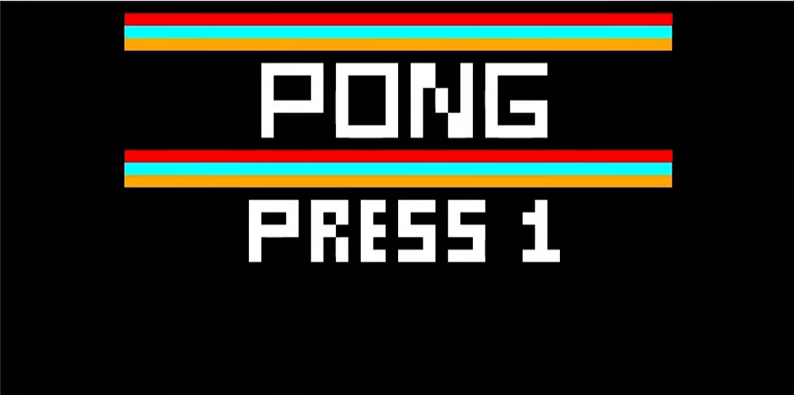

# Proyecto01_EL3310
## Descipción del proyecto
Este programa en RISC-V Assembly permite visualizar el juego "Pong", compilado por medio del simulador RARS. Este corresponde al Proyecto Corto #1 del curso "Diseño de Sistemas Digitales" EL-3310 de la Escuela de Ingeniería Electrónica del Instituto Tecnológico de Costa Rica.

### Características del juego
- 🕹️ **Juego para dos jugadores**: Se juega por medio de dos personas que interactúan con los controles del teclado.
- 🖼️ **Bitmap Display**: Utiliza el Bitmap Display de RARS para mostrar la interfaz gráfica del videojuego.
- 🧩 **Dinámica del juego**: Pelota en movimiento inmediatamente al iniciar que choca con las paletas y los bordes.

### 🛠️ Requerimientos técnicos
- ✅ **RARS**: Descargar en [RARS GitHub](https://github.com/TheThirdOne/rars).
- Nota: Se necesita tener instalado Java 8 o una versión más reciente en su computador para hacer uso de RARS. La versión de RARS es la 1.6. 
- ✅ Acceso al **Bitmap Display** en RARS:
  - 🔳 Unit Width: `8`
  - 🔳 Unit Height: `8`
  - 📐 Display Width: `512`
  - 📐 Display Height: `256`
  - 🗂️ Base Address: `heap`
  - "Connect to Program"
- ✅ Acceso al **Keyboard** in RARS:
  - "Connect to program"

## 🚀 Manual del videojuego
### 📝 Instrucciones de Acceso y Configuración

RARS requiere que las herramientas visuales e interactivas se conecten al programa antes de jugar. Sigue estos pasos cuidadosamente:

Abre el emulador RARS 1.6 y carga el archivo principal del código ensamblador (.asm).

Dirígete al menú superior y selecciona Tools -> Bitmap Display.

Configura los parámetros del Bitmap Display exactamente de la siguiente manera para garantizar que los gráficos calcen en la pantalla:

Unit Width in Pixels: 8

Unit Height in Pixels: 8

Display Width in Pixels: 256

Display Height in Pixels: 256

Base address for display: 0x10040000 (heap)

Haz clic en el botón Connect to Program en la parte inferior de la ventana del display.

Dirígete nuevamente al menú superior y selecciona Tools -> Keyboard and Display MMIO Simulator.

Haz clic en Connect to Program en esta nueva ventana.

Ensambla el código (presionando el botón del destornillador y la llave o F3) y ejecútalo (presionando el botón de Play verde o F5).

### 🏓 Cómo Jugar

Inicio del juego:
Al ejecutar el programa, se mostrará la pantalla de título. Para interactuar con el juego, debes hacer clic obligatoriamente dentro de la caja inferior blanca de la ventana Keyboard and Display MMIO Simulator. Escribe el número 1 para iniciar el modo de dos jugadores.

### 🎮 Controles
Ambos jugadores comparten el mismo teclado físico, enviando los comandos a través de la herramienta MMIO.
- 👤 **Player 1**: `W` (up), `A` (down)
- 👤 **Player 2**: `S` (up), `D` (down)

### 🎯 Objetivo y Reglas:
El objetivo del juego es evitar que la bola pase tu paleta defensiva. Mueve tu paleta verticalmente para hacer rebotar la bola hacia el lado contrario. Cada vez que tu oponente no logre devolver la bola, tú ganarás un punto.

El primer jugador en alcanzar los 10 puntos será declarado ganador y el juego terminará.

## 📹 Enlace al video
https://youtu.be/0oBhAlISlsk

Créditos para ernestoriv7 por risc-v-pong-rars, utilizado bajo MIT License.
